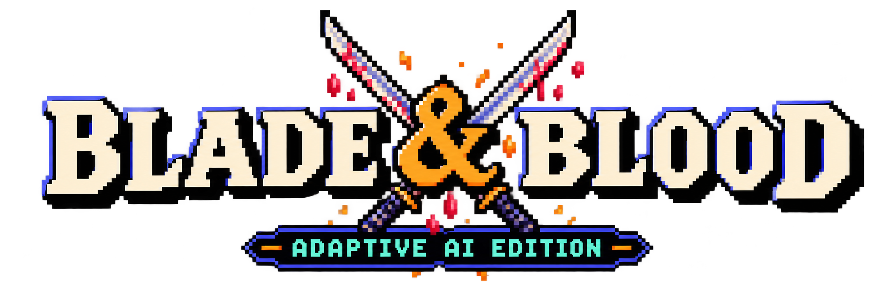
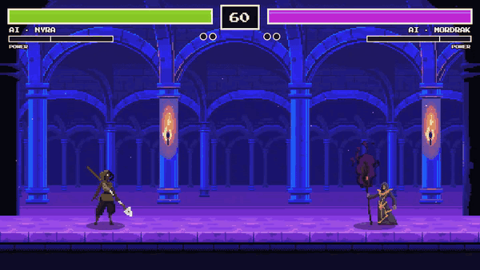
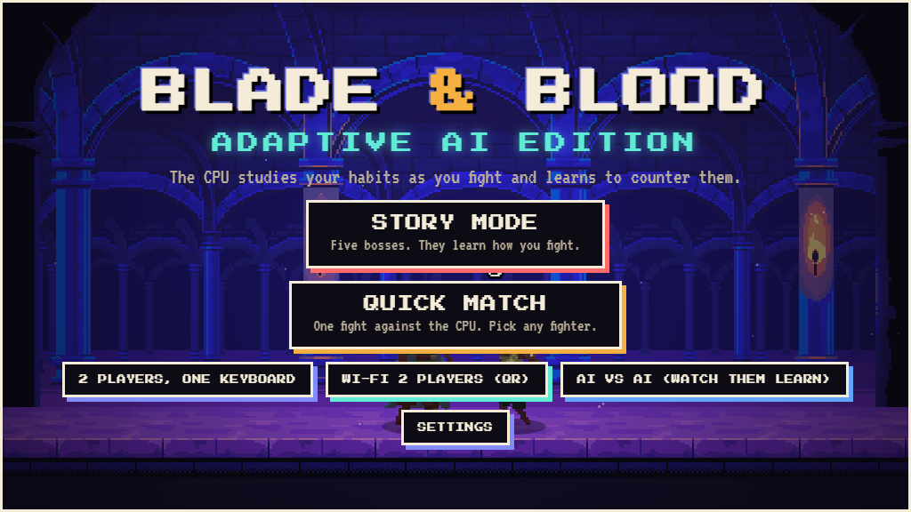
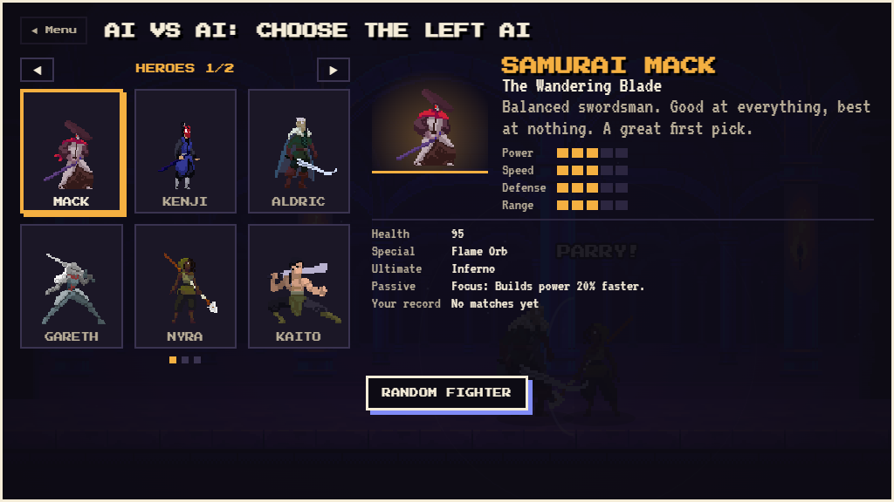
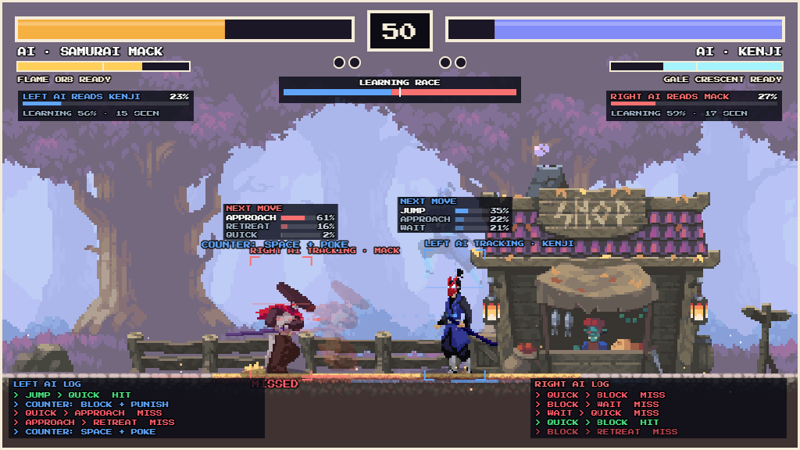
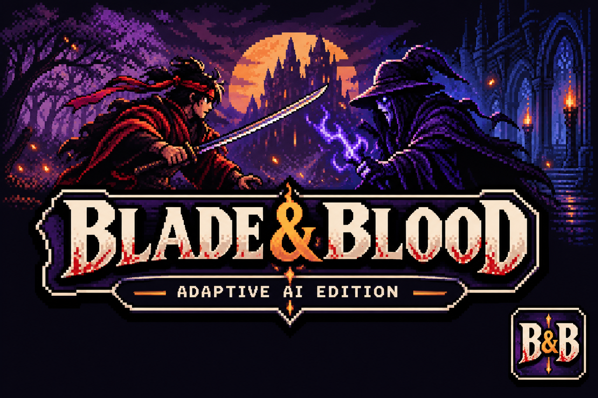

<p align="center">
  
</p>

<p align="center">
  A pixel-art fighting game where the CPU learns how you fight.<br>
  <a href="https://blade-and-blood.web.app"><b>Play it in your browser</b></a>
</p>



| Main menu | Fighter select | AI Vision |
| --- | --- | --- |
|  |  |  |

## Features

- 10 heroes and 5 bosses, each with a special, an ultimate and a passive
- Story mode: five bosses who remember your habits
- A CPU that learns your patterns and counters them
- 2 players on one keyboard, or on two devices over Wi-Fi (QR codes)
- AI vs AI mode and an AI Vision overlay (press V)
- English and Bengali (বাংলা), touch controls on phones

## Controls

| Action | Player 1 | Player 2 |
| --- | --- | --- |
| Move / Jump / Block | A D / W / S | ← → / ↑ / ↓ |
| Dash | Shift | Right Shift |
| Quick / Heavy slash | J / K | , / . |
| Special / Ultimate | L / U | `/` and `'` |
| Throw | O | ; |
| Pause | Esc | |

## Run locally

Serve the folder with any web server, then open http://localhost:8000:

```
python -m http.server
```

## Credits

- Original game: [Tierra Bynum](https://tierrabynum-fighting-game.netlify.app)
- Fighter art: [LuizMelo](https://luizmelo.itch.io) (CC0), Sven Thole (EULA), [Clembod](https://clembod.itch.io), [chierit](https://chierit.itch.io) ([CC BY 4.0](https://creativecommons.org/licenses/by/4.0/))
- Castle arena: [ansimuz](https://ansimuz.itch.io) (CC0)
- Logo and cover: made with ChatGPT
- QR libraries: Kazuhiko Arase (MIT), Cosmo Wolfe (Apache 2.0)
- Fonts: Press Start 2P, VT323, Baloo Da 2 (SIL OFL)

Licence files sit next to each asset. The Sven Thole and Clembod art may not be redistributed outside the game.

<p align="center">
  
</p>
